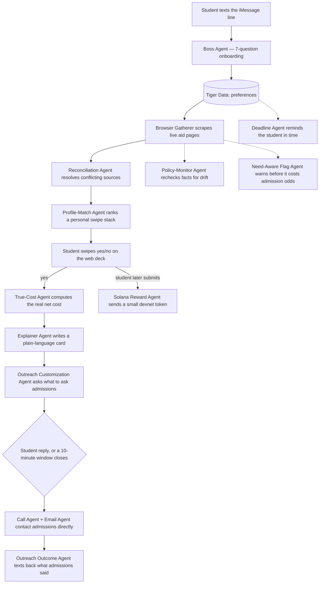
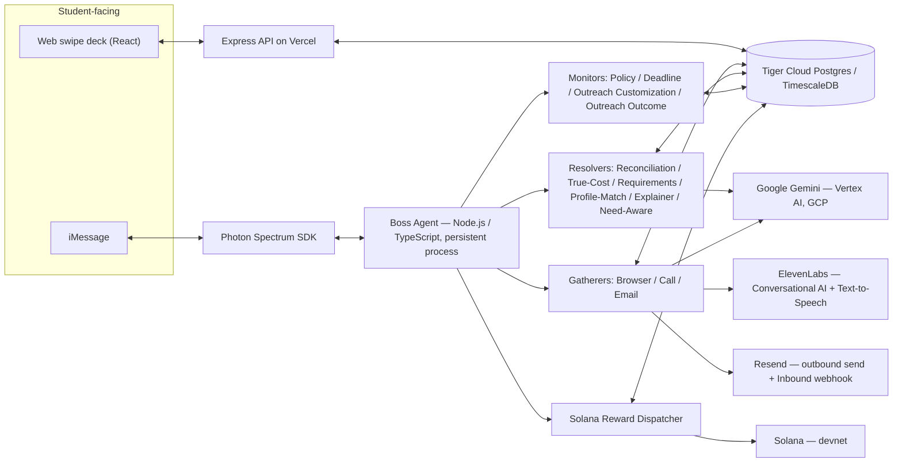

# Scholafinder

**An agent that finds the US universities that will actually pay for an international student to attend — then calls, emails, and follows up with their admissions office, over iMessage.**

Live app: **[scholafinder.vercel.app](https://scholafinder.vercel.app)** · Live agent dashboard: **[scholafinder.vercel.app/orchestration](https://scholafinder.vercel.app/orchestration)**

---

## The problem

Full and near-full scholarships for international undergraduates exist at hundreds of US universities. There is no single list of them. A student has to check thousands of individual university websites one at a time, and international eligibility is frequently never even stated — a page will say "we meet full demonstrated need" without saying for whom. Calling admissions from abroad means international rates, an eight-to-twelve-hour time-zone gap, and an office that doesn't pick up outside its own 9-to-5. Emailing works, but a real reply takes four to five weeks, if one comes at all. And the single costliest mistake — applying for aid at a school that is *need-aware* rather than *need-blind* for international applicants, which can quietly lower your admission odds — is almost never disclosed anywhere a 17-year-old would think to look.

Most students who find a full ride don't find it through research. They find it because a neighbor happened to mention it. That's not a search problem a better search engine fixes — it's an information-access problem, and it falls hardest on exactly the students with the least institutional support: first-generation applicants, students outside the college-counseling-industrial complex, families navigating a second language and a second country's financial-aid system at the same time.

## What Scholafinder does

Scholafinder is a **boss agent that lives in iMessage** — no app to download, no account to create, nothing to learn. A student texts it, answers seven questions, and from there the system does the part that used to take a human weeks: it reads financial-aid pages across thousands of universities, reconciles what it finds into one trustworthy answer per fact (with a confidence score and a provenance trail, not a guess), ranks a personal shortlist, and — once the student swipes yes — **calls and emails the admissions office itself**, asking the specific questions the student actually wants asked, and texts back a plain-language answer when one comes in.

It is built as a roster of specialized agents orchestrated by one boss agent, each with a single job, each independently observable in a live dashboard, writing to a real Postgres database with real foreign keys — not a single long prompt pretending to be a product.

---

## How it works



### System architecture



---

## The agent roster

One boss agent, fourteen specialized subagents. Every box below is a real, independently invocable function writing to real database tables — visible live, mid-flight, in the [orchestration dashboard](https://scholafinder.vercel.app/orchestration).

| Group | Agent | What it actually does |
|---|---|---|
| **Gatherers** | Browser Gatherer | Scrapes a university's own financial-aid pages with Playwright and extracts candidate facts. |
| | Call Gatherer | Places an outbound call to admissions via ElevenLabs Conversational AI, asking the student's chosen questions. |
| | Email Gatherer | Drafts and sends an admissions inquiry via Resend, grounded in what's already known about the school. |
| **Resolvers** | Reconciliation Agent | The keystone agent: when the website, the officer on the phone, and the inbox disagree, this decides what's actually true and records *why*, instead of silently picking a side. |
| | True-Cost Agent | Computes the real, personal net cost — cost of attendance minus the award, plus the international-only line items everyone forgets: health insurance, visa/SEVIS fees, flights, student fees. |
| | Requirements/Packet Agent | Pulls every deadline, required form (CSS Profile, ISFAA), test policy, and fee-waiver option into one packet. |
| | Profile-Match Agent | Scores and orders the swipe stack against the student's own stated preferences — not alphabetical, not random. |
| | Explainer Agent | Turns a database row into a plain-language card a stressed 17-year-old will actually read: who it's for, what it covers, when it's due, what it really costs. |
| | Need-Aware Flag Agent | Surfaces the one hidden fact that changes strategy per school — need-aware vs. need-blind for internationals — before it costs an offer of admission. |
| **Monitors** | Policy-Monitor Agent | Periodically re-scrapes a confirmed fact and flags drift instead of trusting a stale answer forever. |
| | Deadline Agent | Reminds the student, over iMessage, before a deadline — not after. |
| | Outreach Customization Agent | The step most agent demos skip: it asks the student what they actually want asked before a call or email goes out on their behalf, and waits for an answer before acting. |
| | Outreach Outcome Agent | Closes the loop — once a call or email outcome lands, it's the agent that actually tells the student what admissions said. |
| **Reward** | Solana Reward Agent | Sends a small, real devnet SOL transfer the moment a student reports an application submitted. |

---

## Technology

| Layer | What's used |
|---|---|
| Language / runtime | TypeScript end to end, Node.js (ESM), `tsx` |
| Messaging | [Photon's Spectrum SDK](https://photon.codes/spectrum) (`spectrum-ts`) — the live iMessage transport and session layer |
| AI reasoning | Google **Gemini** (`gemini-2.5-flash`) via **Vertex AI on Google Cloud** — structured extraction with JSON-schema-constrained responses, token-streamed prose generation, and automatic retry on transient failures |
| Database | **Tiger Cloud Postgres** (TimescaleDB) — thirteen tables with real foreign keys, confidence scores, and provenance arrays, not a key-value blob |
| Voice | **ElevenLabs** Conversational AI for live outbound calls, plus Text-to-Speech for recorded two-voice demo playback |
| Email | **Resend** for outbound send and for **Inbound** — admissions replies land on a webhook (Svix-signature-verified) that routes back to the exact outreach record that triggered it |
| Payments | **Solana** devnet via `@solana/web3.js` — real on-chain transfers, intentionally devnet-scoped |
| Frontend | React 19, TypeScript, Vite, Framer Motion for the swipe-deck gestures |
| Scraping | Playwright |
| Hosting | **Vercel** for the web app and API; the boss agent itself runs as a persistent process by design — it holds a live iMessage session and cron schedule that a serverless function can't |
| Scheduling | `node-cron` for deadline reminders and nightly policy re-checks |
| Webhook verification | `svix` |

---

## Engineering rigor — this is not a prompt demo

A few concrete things that only show up once a system is actually pushed on, not just pitched:

- **Confidence-and-provenance fact reconciliation.** No agent's output is trusted blind. Every gathered fact is a *candidate* with a source and a confidence score; only the Reconciliation Agent writes to the table the rest of the system trusts, and it marks a fact `conflicting` rather than guessing when two sources disagree.
- **Restart-proof message delivery.** Proactive messages (a deadline reminder, a call outcome) originally depended on an in-memory map that only knew about a student after they'd texted in that process's lifetime — meaning a restart silently dropped every background notification. It now resolves a send-capable session directly from the student's stored platform identifier, using Spectrum's documented space-resolution API rather than the simple inbound-message loop most integrations stop at.
- **Error isolation, not a single try/catch around everything.** Every background poller processes its batch with per-record isolation, so one unreachable student or rejected send can't silently cancel another student's outreach mid-batch — a real bug that existed, was caught, and was fixed during this build, not assumed away.
- **Real end-to-end verification, not screenshots.** The reward flow was tested against real devnet traffic and produced a real, verifiable transaction signature. The onboarding and outreach-customization flow were driven against the live Spectrum connection, not a mock.
- **A data-integrity bug found and repaired, live.** The universities table was missing a uniqueness constraint, so a reseed could silently duplicate a row. It was caught by inspecting the data rather than trusting the seed script, the duplicates were merged back together without losing any real student history, and the constraint was added so it can't happen again.
- **Honest fallback behavior.** If a generated explainer card fails, the system doesn't show the student a placeholder message with no new information — it simply doesn't interrupt them, because the real facts are already on the card they just looked at.

---

## Best Photon: Agents in iMessage integration

> *"Real human-in-the-loop collaboration, not a demo reel of prompts. Context-awareness that persists across time, channels, and teammates. A delightful default: the agent elevates the moment without demanding attention. Thoughtful safety and fallback behaviors that earn trust."*

| What Photon is judging | What Scholafinder delivers |
|---|---|
| **Vision** — does this push the frontier of hybrid intelligence? | The agent never acts on a student's behalf without them. Before a call or email goes out, the Outreach Customization Agent explicitly asks what they want asked and waits for an answer — a real pause for human judgment, not an autonomous action dressed up as collaboration. |
| **Craft** — is it cohesive, responsive, and tastefully integrated? | One identity flows across iMessage, the web swipe deck, and background monitoring, with a live token-streamed dashboard showing every agent's real activity as it happens — not a static architecture slide. |
| **Depth** — how well does it handle real-world context and edge cases? | Network interruptions, duplicate data, a bad wallet address, a Gemini timeout, an unreachable student mid-batch — each of these is a real condition this build hit and now handles gracefully, documented above, not hypothetically. |
| **Traction** — can we imagine this running with real users tomorrow? | It already ran with a real phone number, over a real iMessage session, through onboarding, swiping, and outreach, end to end, before this was written. |

Scholafinder's entire interaction surface is **Spectrum**: the live inbound message loop, outbound sends, and the restart-proof session-resolution path all go through Photon's SDK — not a wrapper around it for one onboarding step and a generic chatbot everywhere else.

## Best Solana Integration

| Criterion | Honest answer |
|---|---|
| **Solana-native advantage** | The reward is a micro-incentive paid to potentially thousands of students for a real action (a completed application) — a use case that only works economically at sub-cent fees and near-instant finality. This is the right-sized problem for Solana, not a generic ledger entry that happens to run on it. |
| **Working demo** | Real, not promised: a live devnet transfer was sent and confirmed during this build, with a verifiable on-chain transaction signature. |
| **Technical complexity** | Today this is a native `SystemProgram` transfer via `@solana/web3.js`, deliberately scoped to devnet for safety — not yet a custom Anchor program. The honest next step, and the obvious one, is a program that escrows and releases rewards per verified milestone (submitted → confirmed → enrolled) instead of a single transfer, which is exactly the kind of on-chain state machine Anchor is for. |
| **Design/UX** | A student never sees a wallet UI, never signs a transaction, never thinks about gas. They paste an address in iMessage, it's validated before anything is attempted, and a friendly re-prompt handles a mistake — crypto complexity stays entirely off the student's plate. |
| **Novelty** | AI agents, an international-education financial-access problem, and Solana payments rarely appear in the same sentence, let alone the same working system. |
| **Impact/usefulness** | Concrete user, concrete before/after: an international student who finishes a hard, intimidating application gets an immediate, verifiable token of recognition seconds later, at a cost to the platform of fractions of a cent even at scale. |
| **Presentation** | This table exists on purpose. |

We've also already registered **rizzmytuition.biz** on GoDaddy — a lighter, shareable front door for the audience this is actually built for, sitting alongside the more formal Scholafinder brand used with schools and counselors.

## Why this wins Fintech

> *"Rethink how money moves: payments, budgeting, investing, and the tools that make finances easier to manage."*

Financing a US education as an international student is one of the largest, least transparent financial decisions a family ever makes — routinely $200,000–400,000 over four years, decided under a four-to-five-week email-reply cycle, in a second country's aid system, often in a second language. Scholafinder's True-Cost Agent computes the real number — sticker price minus aid, plus the international-only costs everyone forgets — before a family commits. The Requirements/Packet Agent tells them exactly which financial forms a given school actually requires. The Explainer Agent turns all of it into a plain-language card instead of a financial-aid PDF. And the Solana Reward Agent is a working, real example of a near-zero-cost payment rail attached directly to a financial milestone. This isn't a budgeting app bolted onto a chatbot — it's a system built around the actual, specific financial decision it exists to de-risk.

**Why I'm the right person to build this:** I learned the Presidential Scholarship I eventually built this whole system around existed because a neighbor happened to mention it — not because any official channel told me. That's the entire problem, lived firsthand, not researched secondhand: the students who most need this information are the ones least likely to have someone in their life who already has it. I built the full stack myself — the agent orchestration, the database schema and reconciliation logic, the live iMessage integration, the real outbound calling and email pipeline, the on-chain reward — because a financial-access problem this specific doesn't get solved by a frontend wrapped around someone else's API.

---

## Try it

- **Landing + swipe deck:** [scholafinder.vercel.app](https://scholafinder.vercel.app)
- **Live agent dashboard:** [scholafinder.vercel.app/orchestration](https://scholafinder.vercel.app/orchestration) — every agent's real activity, streamed live
- **iMessage:** the boss agent runs as a persistent local process (by design — it holds a live session a serverless function can't), so it's live whenever that process is running rather than hosted 24/7; ask for a walkthrough

## Running it locally

```bash
npm install
npx playwright install chromium
cp .env.example .env   # then fill in the keys below
```

### Required env vars (`.env`)

| Var | Where to get it |
|---|---|
| `GEMINI_API_KEY` or `GOOGLE_CLOUD_PROJECT` + `GOOGLE_APPLICATION_CREDENTIALS` | [Google AI Studio](https://aistudio.google.com/apikey), or a GCP service account for Vertex AI — every agent's reasoning runs through this |
| `DATABASE_URL` | Tiger Cloud connection string. Add `&uselibpqcompat=true` to the query string or you'll hit a self-signed-cert error. |
| `SPECTRUM_PROJECT_ID` / `SPECTRUM_PROJECT_SECRET` | [app.photon.codes](https://app.photon.codes) — promo code `HACKWITHPHOTON` for a free Pro month. Only needed once `SPECTRUM_PROVIDER` is switched to `imessage`; the `terminal` provider needs neither. |
| `ELEVENLABS_API_KEY` / `ELEVENLABS_AGENT_ID` / `ELEVENLABS_AGENT_PHONE_NUMBER_ID` | ElevenLabs dashboard. The phone-number ID only exists after a Twilio number is imported into ElevenLabs (Conversational AI → Phone Numbers); outbound calls fall back to a recorded two-voice demo until then. |
| `RESEND_API_KEY` / `EMAIL_FROM_ADDRESS` | [resend.com](https://resend.com) |
| `RESEND_INBOUND_DOMAIN` / `RESEND_WEBHOOK_SECRET` | Enable Resend's Inbound feature on a receiving domain and add a webhook endpoint subscribed to `email.received` — routes real admissions replies back to the right student. |
| `SOLANA_REWARD_WALLET_SECRET_KEY` | A devnet keypair (`Keypair.generate()`), funded via `solana airdrop` or https://faucet.solana.com. |

### Run it

```bash
npm run db:schema      # create tables (idempotent)
npm run db:seed        # load the seeded university roster + researched baseline facts
npm run reconcile      # resolve candidate facts into the confirmed scholarship_facts table
npm run dev:terminal   # boss agent over the terminal provider — no phone needed
```

Once `SPECTRUM_PROJECT_ID`/`SECRET` are set, switch `SPECTRUM_PROVIDER=imessage` in `.env` and run `npm run dev` to go live on a real phone number.

## How it's organized

- `src/db/` — schema, seed data, one-off runners. `scholarship_fact_candidates` → `scholarship_facts` is the keystone pattern: every gatherer writes candidates, only `reconciliationAgent` writes confirmed facts.
- `src/agents/` — one file per subagent in the roster.
- `src/boss/` — the only thing that talks to the student: onboarding, the shared reply voice, session resolution, and the main event loop in `index.ts`.
- `src/reward/solana.ts` — the devnet SOL transfer on a reported submission.
- `src/llm.ts` — the single choke point for every LLM call.
- `web-app/` — the landing page, swipe deck, and live orchestration dashboard (React + Vite).

## What's next

- A custom Anchor program for the reward flow, replacing a single transfer with milestone-based escrow and release.
- Promoting the researched seed baseline into live, continuously re-verified facts across the full university list, not just the current roster.
- Turning on real outbound calling (a Twilio number imported into ElevenLabs) everywhere the recorded demo currently stands in.
- Launching the `rizzmytuition.biz` front door alongside Scholafinder's own domain.

---

Built for Photon's *Agents in iMessage* track, on top of [Photon's Spectrum SDK](https://photon.codes/spectrum), Google's Gemini via Vertex AI, Tiger Cloud Postgres, ElevenLabs, Resend, and Solana.
